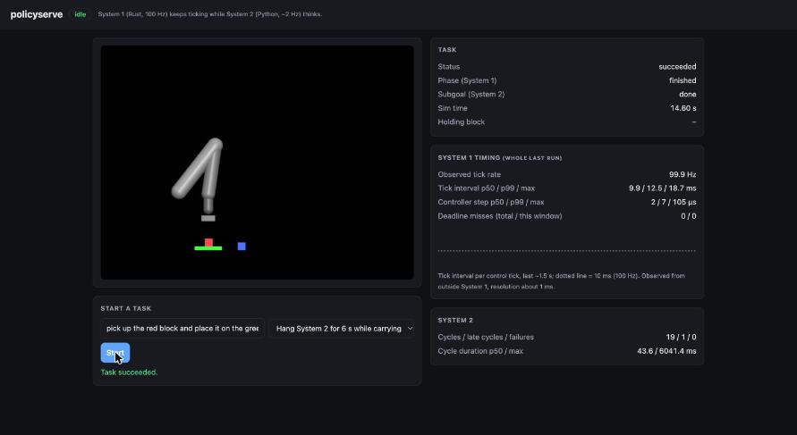

# PolicyServe

A real-time serving layer for robot control policies implementing the
dual-rate "System 2 / System 1" architecture used in production
vision-language-action (VLA) robotics stacks: a slow multimodal
reasoner decides *what to do next*, a fast local controller decides
*how to move right now*, and the two run decoupled so the fast loop
never stalls waiting on the slow one.

**Status:** milestones 1-6 done: a Rust fast loop (System 1) and a Python slow reasoner (System 2) complete a simulated
pick-and-place together through shared memory, keep doing the right thing when System 2 is hung for 5-6 real seconds or
System 1 deliberately blows its own tick budget, and can be driven and watched live through an HTTP API and a browser viewer
(see `docs/milestones.md`). The real multimodal LLM reasoner is next.

**The claim, measured** (real runs of `py/tests/test_faults.py`, wall-clock, real Rust binary, real MuJoCo scene):

| Fault | What System 1 did |
|---|---|
| System 2 hung 6 s while the arm carried the block | 599 ticks in the 6.01 s (100.0/s), 0 deadline misses, gripper stayed closed on the block, arm still within 4 mm, task finished after System 2 came back |
| System 2 hung 5 s during the approach | 499 ticks in 5.01 s, finished the committed motion, held at the next waypoint, task finished after recovery |
| Every 25th controller call made 8 ms slower (5 ms budget) | all 40 overruns caught and counted, none missed, each replaced by a zero-velocity command and reported at its real duration, task still finished |

## Watch it live

```bash
cargo build --release
cd py && .venv/bin/python -m policyserve.api        # http://127.0.0.1:8000  (no authentication: localhost only by default)
```

Open the page, pick "Hang System 2 for 6 s while carrying", press Start. The page shows the live frame, System 2's current subgoal,
System 1's phase and a rolling timing readout. The screenshot is taken during that run, while System 2's cycle took 6041 ms:
System 1 is still at 100.0 Hz with 0 deadline misses.



API: `POST /tasks`, `GET /tasks/{id}`, `GET /metrics?window=10`, `GET /stream` (Server-Sent Events), `GET /healthz`
(503 if System 1 stops ticking during a task). One task at a time (409 otherwise). Interactive docs at `/docs`.

```bash
cargo build --release
cd py && python -m venv .venv && .venv/bin/pip install -e . && .venv/bin/python -m pytest tests -q
.venv/bin/python -c "from policyserve.host import PickPlaceHost; r = PickPlaceHost().run(); print(r.success, r.sim_time, r.system1['transitions'])"
```
