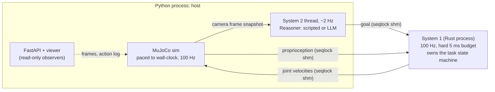

# PolicyServe

A real-time serving layer for robot control policies, implementing the dual-rate "System 2 / System 1" architecture used in
vision-language-action (VLA) robotics stacks: a slow multimodal reasoner decides *what to do next*, a fast local controller decides
*how to move right now*, and the two run decoupled so the fast loop never stalls waiting on the slow one.

Everything here is simulated (MuJoCo, one arm, one pick-and-place task). There is no real hardware. What is real is the architecture:
two processes in two languages, a lock-free handoff between them, a hard per-tick deadline, and measured behaviour when each side fails.


*The live viewer during a run in which System 2 was made to hang for 6 seconds while the arm carried the block. System 2's longest
cycle was 6041 ms; System 1 stayed at 100.0 Hz with 0 deadline misses and the task still finished.*

## The claim, measured

Real runs (`py/tests/test_faults.py`, wall-clock, the real Rust binary, the real MuJoCo scene):

| Fault | What System 1 did |
|---|---|
| System 2 hung 6 s while the arm carried the block | 599 ticks in 6.01 s (100.0/s), 0 deadline misses, gripper stayed closed on the block, arm still within 4 mm, task finished after System 2 came back |
| System 2 hung 5 s during the approach | 499 ticks in 5.01 s, finished the committed motion, held at the next waypoint, task finished after recovery |
| Every 25th controller call made 8 ms slower (5 ms budget) | all 40 overruns caught and counted, none missed, each replaced by a zero-velocity command and reported at its real duration, task still finished |

Undisturbed, on the same machine: 100.0 Hz, tick interval p50 10.0 ms / p99 about 14 ms, zero deadline misses, and a task takes about
10 simulated (and wall-clock) seconds. The same numbers hold inside the Linux Docker image.

## Run it

```bash
docker compose up --build            # then open http://127.0.0.1:8000
```

Pick "Hang System 2 for 6 s while carrying" in the viewer and press Start. Without Docker:

```bash
cargo build --release
cd py && python -m venv .venv && .venv/bin/pip install -e ".[llm]"
.venv/bin/python -m policyserve.api              # http://127.0.0.1:8000
.venv/bin/python -m pytest tests -q              # about 3 minutes: the closed-loop tests run in real time
```

The API (also at `/docs`): `POST /tasks`, `GET /tasks/{id}`, `GET /metrics?window=10`, `GET /stream` (Server-Sent Events: JPEG frame +
goal + timing at ~10 Hz), `GET /healthz` (503 if System 1 stops ticking during a task). One task at a time (409 otherwise).
There is no authentication, so the server binds to localhost; Compose publishes the port on the host's loopback only.

## Architecture



- **System 1 (Rust, `src/`)** reads the newest goal without ever blocking, runs the controller under a hard budget, and publishes a
  velocity command every tick. A step that overruns its budget is logged and replaced with a zero-velocity command, never applied late.
  It owns the grasp / lift / transport / release state machine; System 2 only says *where*.
- **System 2 (Python, `py/policyserve/system2.py`)** runs a `Reasoner` on a fixed cadence. A slow cycle makes the next one start late (no
  catch-up burst); a crashing or malformed reasoner leaves the previously published goal untouched and, after three in a row, publishes a
  `FAILED` sentinel.
- **The handoff** is a seqlock over POSIX shared memory (`src/shm.rs`, `py/policyserve/shm.py`): single writer, single reader, O(1), no lock
  ever held across a slow call.
- **The LLM reasoner (`py/policyserve/reasoner_llm.py`)** is opt-in. See below.

## The LLM reasoner

`POST /tasks {"instruction": "...", "reasoner": "llm"}` swaps the scripted reasoner for a real multimodal model (needs
`ANTHROPIC_API_KEY`; the model defaults to `claude-haiku-5-5`, override with `POLICYSERVE_LLM_MODEL`). The model sees the frame, the
instruction and a few scene facts, and picks the next subgoal through one forced tool call: `reach`, `place`, `done` or `fail`.

- **It never produces coordinates.** Positions come from the same colour-blob perception the scripted reasoner uses, so a model that cannot
  measure pixels precisely cannot send the arm somewhere wrong.
- **Its output is validated before it can reach System 1**: unknown action or colour, reaching the platform, placing on a block, naming an
  object that is not visible, or claiming `done` while the block is not actually on the platform all raise. System 2's loop counts that as a
  failed cycle and leaves the old goal in place.
- **The instruction is untrusted text.** It is delimited, the system prompt says to treat it as data, and the output is a closed enum, so
  the worst a hostile instruction can do is choose a different valid subgoal.
- **No retries, a call budget (120 per task) and an 8 s timeout**: a slow or failed call just makes that cycle late or failed while System 1
  keeps going.

**What is and is not verified:** all of the above is tested offline with a fake model client, including a full closed-loop task through the
LLM path against a stand-in "model" with 0.3 s latency. A run against a live model has not been done: `test_live_model_completes_the_task`
exists and is skipped unless `ANTHROPIC_API_KEY` is set.

## Design decisions and tradeoffs

- **Seqlock shared memory, not a queue or a socket.** The goal and the action are "latest value wins" state, not a stream; a queue would let
  stale goals pile up and a lock would couple the fast loop to the slow one. The cost: it only works for one writer and one reader, and it
  needs care with memory ordering (see the bug below).
- **Rust for System 1.** No garbage collector and no interpreter lock, so a deadline is a property of the code, not of luck. Python stays where
  the ecosystem is (MuJoCo, models, the API).
- **System 1 refuses stale goals.** It only acts on a goal computed from a frame captured after its last sequence ended; otherwise a `DONE`
  computed a moment too early would end the task with the block still in the gripper.
- **A deadline miss means "apply a known-safe command this tick", not "skip the tick"**: ticks have to stay regular for the loop's rate to
  mean anything.
- **Timing is observed from outside.** The host has an independent thread polling the action channel far faster than 100 Hz; the API's tick
  rate and interval come from that, not from System 1 grading itself. (The host's own 100 Hz read is phase-locked to System 1's tick and
  systematically misses the late, over-budget records, which is how this was found.)
- **A deterministic scripted reasoner is the default** so every claim above is reproducible without a model or a key; the LLM is a plug-in
  behind the same interface.
- **Two processes in one container.** They talk through shared memory, which only works within one `/dev/shm`.

## Real problems found by running it

- The first seqlock was wrong on ARM64: a Release store does not order the payload writes before it, and an Acquire load does not order the
  reads after it, so a reader could accept a half-written value (7 of 15 runs failed under load). Fixed with explicit fences.
- MuJoCo's default angle unit is degrees, so `range="-3.14159 3.14159"` meant +-3 degrees and the arm stalled against an invisible limit.
- A held block slid out of the pads because MuJoCo's default contacts are too soft; stiffer `solref` fixed it, friction changes did not.
- With software GL (the Docker image), a render context left to the garbage collector was destroyed in the middle of the *next* run and
  corrupted its frames (wrapped, colour channels swapped), so System 2 saw a block that was not there. About one run in five failed until
  the host closed its context itself. This never showed on macOS and was found by running the suite in Linux.
- A closed-loop run cannot be sped up: System 2 plans on a wall-clock cadence, so a simulation at 40x real time outruns it and System 1
  gives up waiting for a goal.

## Deliberately out of scope

A real robot or real-time OS (the host is a normal process; `wait_goal` has no timeout by design, and on hardware that needs a watchdog); a
hung System 1 (the host would keep applying its last action, a different failure with a different answer); a learned detector (perception is
a colour-blob finder on purpose); more than one scene or task shape; authentication; shared-memory corruption beyond the torn-read test.

## Layout

```
src/                 System 1 (Rust): seqlock channel, controller + deadline, kinematics, task state machine, control loop
py/policyserve/      host (MuJoCo + wiring), system2, reasoner (scripted), reasoner_llm, faults, api, viewer/
py/tests/            70 Python tests (shm interop, sim, System 2, closed loop, faults, API, LLM reasoner); 22 more in src/
docs/                system-design.md (the design), milestones.md (what was built and found, per milestone)
Dockerfile, docker-compose.yml, scripts/smoke.sh, .github/workflows/ci.yml
```
