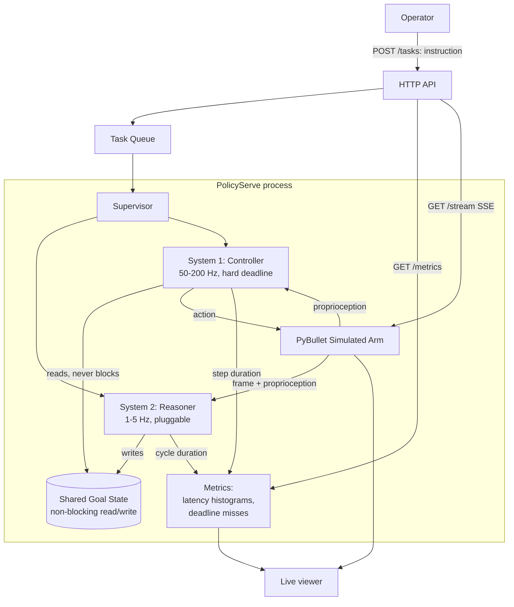

# PolicyServe — System Design

## 1. Problem

Every production robot-learning stack in 2026 runs two models at once,
not one: a slow, expensive multimodal reasoner that decides *what the
robot should be doing* (parse a natural-language instruction, look at
the scene, pick the next subgoal), and a fast, cheap local controller
that decides *how to move right now* (joint/end-effector commands,
tens to hundreds of times a second). The reasoner runs at 1–5 Hz and
can take hundreds of milliseconds per call; the controller must run at
50–200 Hz with a single-digit-millisecond budget per step, because a
stalled control loop on real hardware means a dropped object, a
missed grasp, or a robot arm in an unsafe position.

The actual engineering problem — decoupling those two loops so the
slow one's latency (or an outright failure/timeout) never blocks the
fast one, while still keeping the fast loop pointed at a reasonably
fresh goal — is a solved pattern inside companies shipping VLA
(vision-language-action) robots, but there is no small, open,
inspectable reference implementation of it. Everything published
either *is* a full VLA model (a research artifact, not a serving
architecture) or assumes the serving layer as a given. PolicyServe is
that missing serving layer, built against a simulated robot so no
hardware is required to run it.

Today, teams either reinvent this glue themselves (usually as an
afterthought once the "it works but sometimes judders" bug shows up
in integration testing) or bolt a general-purpose model-serving
framework (Triton, Ray Serve) onto the problem, neither of which has
any native concept of "two loops at two rates sharing one piece of
state, one of which has a hard deadline."

## 2. Users & use cases

Primary user: a robotics/robot-learning engineer integrating a VLA-style
policy onto a robot (simulated or real) who needs the serving
architecture around the model, not another model.

1. **Submit a task.** An operator sends a natural-language instruction
   ("pick up the red block and place it on the blue platform") to a
   running PolicyServe instance controlling a simulated arm. The System
   2 reasoner breaks it into a sequence of subgoals; the System 1
   controller drives the arm through them; the operator watches it
   happen (live state stream) and gets a final success/failure result.
2. **Diagnose a timing problem.** An engineer suspects the control loop
   is missing its deadline under load. They query `/metrics` for the
   per-loop latency histogram and deadline-miss count instead of
   guessing from video footage of a twitchy arm.
3. **Swap the reasoner without touching the controller.** A team
   wants to try a different System 2 implementation (a different
   model, a different prompting strategy, a scripted planner for
   deterministic testing) without changing anything about how System 1
   runs or how deadlines are enforced — the two are deliberately
   decoupled behind one interface.
4. **Prove the fast loop survives a slow/dead reasoner.** An engineer
   runs a fault-injection test: System 2 hangs for 5 real seconds.
   PolicyServe's own test suite asserts System 1 kept running at its
   target rate the entire time, acting on its last-known goal.

## 3. Requirements

### Functional
- Accept a natural-language task instruction plus a simulated camera
  frame and proprioceptive state; drive a simulated robot arm (PyBullet)
  toward completing it.
- Run a **System 2** reasoner on its own cadence (default 2 Hz,
  configurable) that reads the latest frame/instruction/state and
  writes a structured subgoal (a target end-effector pose, or
  "done"/"failed") into shared goal state. Pluggable: a deterministic
  scripted planner (for tests/CI, zero cost, zero network) and a real
  multimodal-LLM-backed planner (for the live demo) implement the same
  interface.
- Run a **System 1** controller on its own fixed-rate loop (default
  100 Hz) that reads the latest goal (non-blocking, never waits on
  System 2), computes a bounded low-level action via a closed-form
  controller, and applies it to the simulated robot — never skipping a
  tick to wait for a fresh goal.
- Enforce a hard per-step compute budget on System 1 (default 8 ms
  inside a 10 ms period); a step that exceeds it is logged as a
  deadline miss and falls back to a safe action (hold position) rather
  than applying a half-computed or stale-beyond-policy command.
- Expose task submission/status, live state, and timing metrics over
  an HTTP API.
- A minimal live viewer: current sim frame, current goal, and a
  rolling latency/deadline-miss readout, updating in real time.

### Non-functional
- System 1's loop **frequency must not degrade** regardless of System
  2's latency, up to and including System 2 hanging indefinitely —
  proven by an explicit fault-injection test, not assumed.
- System 1's own step latency distribution (p50/p99/max) must be
  directly observable, not just "the robot looked smooth."
- The deterministic scripted planner must make the entire system
  runnable in CI with zero external network calls and zero API cost;
  the LLM-backed planner is strictly opt-in via config.
- No hardware required — the simulated arm is the only "robot" this
  project targets; the System 1/System 2 interface is the same
  boundary a real robot's driver would sit behind, but driving real
  hardware is explicitly out of scope (see §4).

## 4. Scope

**In scope for v1:** a simulated single-arm pick-and-place task; the
dual-rate System 2/System 1 architecture with a pluggable reasoner
interface; a scripted deterministic planner and one real
multimodal-LLM-backed planner; hard deadline enforcement with a safe
fallback action and full observability of it; an HTTP API for task
submission/status/metrics; a minimal live viewer.

**Explicitly out of scope for v1:** real robot hardware of any kind;
training any model (the "VLA" is either a scripted stand-in or a
general-purpose multimodal LLM called with a carefully constructed
prompt — this project is the serving architecture around a policy, not
a trained policy); multi-robot/multi-arm coordination; obstacle
avoidance/motion planning beyond straight-line end-effector moves with
joint-limit clamping; any task harder than single-object pick-and-place.

**Possible v2:** a second, real learned policy (e.g. a small imitation-
learning model) as an alternative System 1 implementation, to compare
against the closed-form controller; multi-arm scheduling; a second
simulated robot morphology (mobile base, not just a fixed arm).

## 5. Architecture



**Hot path (System 1, every tick):** read the latest goal from shared
state (a single non-blocking read, never a lock held across System 2's
own work) → compute a bounded action with the closed-form controller →
apply it to the sim → record step duration → if duration exceeded the
budget, log a deadline miss and this tick's action is forced to the
safe fallback instead of whatever was computed.

**Planning path (System 2, every cycle):** read the latest frame +
proprioception + the active task's instruction → run the pluggable
reasoner (scripted rules, or a real multimodal LLM call) → write the
resulting subgoal into shared state. A System 2 cycle that takes
longer than its own period simply means the *next* cycle starts late;
it never touches System 1's timing at all, by construction — they
share data, never control flow.

**Failure path:** if System 2 raises, times out, or returns malformed
output, the shared goal state is left unchanged (System 1 keeps
driving toward the last good goal) and the failure is counted in
metrics; after N consecutive System 2 failures the task is marked
failed, but System 1 never stops ticking.

## 6. Data model

(In-process state for v1 — no database. §9 covers what persistence
would add and why it's deferred.)

**Task**

| field | type | notes |
|---|---|---|
| id | uuid | |
| instruction | string | the raw natural-language instruction |
| status | enum | `pending` \| `running` \| `succeeded` \| `failed` |
| created_at / finished_at | timestamp | |
| result | string? | final subgoal outcome or failure reason |

**GoalState** (single current value, not a history table)

| field | type | notes |
|---|---|---|
| subgoal | struct | target end-effector pose, or `done`/`failed` sentinel |
| source_cycle | int | which System 2 cycle produced this |
| updated_at | timestamp (monotonic) | used by System 1 to tell how stale the goal is |

**LoopMetric** (ring buffer, not unbounded)

| field | type | notes |
|---|---|---|
| loop | enum | `system1` \| `system2` |
| duration_ms | float | |
| deadline_ms | float | the budget this loop was held to, if any |
| missed | bool | `duration_ms > deadline_ms` |
| timestamp | monotonic | |

## 7. API surface

- **`POST /tasks`** `{instruction: string}` → `{task_id}`. Starts a new
  task; rejects with 409 if a task is already running (v1 drives one
  arm, one task at a time).
- **`GET /tasks/{id}`** → task status, current subgoal, elapsed time.
- **`GET /metrics`** → p50/p95/p99/max step duration and deadline-miss
  count for each loop, over a configurable recent window.
- **`GET /stream`** (SSE) → a live feed of sim frames, current
  subgoal, and per-tick timing, for the viewer (and for anyone who
  wants to watch without polling).
- **`GET /healthz`** → process-level liveness, including "is System 1
  still ticking at its target rate" — the one check that matters most.

## 8. Key algorithms / mechanisms

### 8.1 Non-blocking cross-rate state sharing

```
# System 2 (slow writer)
goal = reasoner.plan(frame, instruction, state)   # can take 100s of ms
shared_goal.swap(goal)                             # atomic pointer swap,
                                                     # never a lock held
                                                     # across reasoner.plan()

# System 1 (fast reader), every tick:
goal = shared_goal.read()                          # always returns
                                                     # instantly with
                                                     # whatever the last
                                                     # completed write was
action = controller.compute(goal, proprioception)
```

The critical property: `shared_goal.read()` and `shared_goal.swap()`
are both O(1) and never contend on anything System 2's own (slow) work
is doing. This is a single-producer/single-consumer handoff, not a
general-purpose shared data structure — deliberately, since that's all
this needs and anything fancier (a queue, a lock held longer than a
pointer swap) reintroduces exactly the coupling this project exists to
avoid.

### 8.2 Hard deadline enforcement with a safe fallback

```
start = now()
action = controller.compute(goal, proprioception)
elapsed = now() - start
if elapsed > BUDGET_MS:
    record_deadline_miss(elapsed)
    action = SAFE_FALLBACK_ACTION   # hold position -- never apply a
                                     # command computed under a budget
                                     # violation, even if it finished
apply(action)
record_step(elapsed)
```

The fallback isn't "skip this tick" (ticks must stay regular for the
loop's own rate to be meaningful) — it's "apply a known-safe action
this tick instead." What counts as safe (hold position vs. decelerate
toward zero velocity) is a controller-level decision documented inline,
not hidden in this generic loop.

### 8.3 Reasoner interface (the System 2 plug point)

```
interface Reasoner:
    def plan(frame, instruction, proprioception) -> Subgoal | Done | Failed

ScriptedReasoner implements Reasoner:
    # deterministic rule: find the named-color block in `frame` via a
    # simple color-blob heuristic (not a learned detector -- the point
    # is determinism for tests, not detection quality), subgoal = its
    # position; once grasped, subgoal = the named platform's position.

LLMReasoner implements Reasoner:
    # sends `frame` + `instruction` + a short structured-output prompt
    # to a real multimodal LLM; parses its response into the same
    # Subgoal type. Opt-in via config; the only part of this project
    # with real network/API cost.
```

Both implementations satisfy the same interface and the same timing
contract (System 2's own cadence, not System 1's deadline) — swapping
one for the other must never require touching System 1 at all. This is
the seam the "swap the reasoner without touching the controller" use
case (§2.3) and the fault-injection test (§2.4) are both built on.

### 8.4 System 2 cadence policy

Fixed-interval by default (every 500ms, configurable) rather than
triggered-on-change: a fixed cadence is what makes the "System 2 hangs
for 5 seconds, System 1 keeps ticking" test meaningful and repeatable.
Event-triggered re-planning (e.g. "re-plan immediately if the tracked
object moved more than X") is a reasonable v2 addition, noted rather
than built, since it adds a second code path to the exact seam this
project is trying to keep simple.

## 9. Scaling & failure modes

- **System 2 is slow, hangs, or dies.** The entire point of §8.1/8.2 —
  System 1 must keep ticking at its target rate regardless, acting on
  the last good goal. Proven by an explicit fault-injection test
  (System 2 artificially delayed/killed mid-run), not just argued from
  the architecture.
- **System 1's own compute exceeds budget.** §8.2's safe-fallback path;
  tracked as a first-class metric, not a silent degradation. A
  sustained high deadline-miss rate is the signal an engineer would
  actually page on in a real deployment.
- **The simulated robot reaches a singular/unsafe configuration.** The
  controller clamps commanded velocities against joint limits before
  they ever reach the sim; a configuration PyBullet itself rejects
  (self-collision) ends the task as `failed` rather than wedging the
  loop.
- **No persistence layer.** v1 is explicitly single-process, single-
  task, in-memory (§6) — a real deployment would want task history and
  metrics in a real time-series store, but that's an orthogonal
  concern to the actual engineering problem this project targets
  (the dual-rate serving architecture), so it's deferred rather than
  built and left shallow.

## 10. Tech / language options

| Option | System 1 (hot loop) | System 2 + sim | Tradeoff |
|---|---|---|---|
| A: Python end-to-end | Python (asyncio or a tight `while` loop in its own thread/process) | Python (PyBullet is Python-only) | Simplest to build end-to-end; the GIL makes a *hard* 100Hz+ deadline a real engineering problem to solve honestly (multiprocessing to actually decouple the two loops, not just `async def`), which is arguably more interesting to demonstrate solving than to sidestep. |
| B: Rust (System 1) + Python (System 2/sim) | Rust, talking to the sim over a lightweight IPC/shared-memory channel | Python (PyBullet) | The most legitimate "hard real-time" story and a second strong language credential; meaningfully more glue code to bridge a Rust loop into a Python-only physics sim cleanly. |
| C: Go (System 1) + Python (System 2/sim) | Go | Python (PyBullet) | Similar split to B with an easier IPC story (Go's networking/concurrency primitives); Go's GC can introduce latency jitter that complicates the "hard deadline" story, though still far more deterministic than Python's GIL. |

No recommendation locked in yet — this is the call to make at the
language-decision step, after this design is reviewed.

## 11. What this demonstrates on a résumé

Real-time systems engineering under an explicit, measured latency
budget (not "it felt responsive" but "p99 step latency and deadline-
miss rate are a tracked metric"); decoupled dual-rate control-loop
architecture, the actual production pattern behind 2026's VLA robotics
stacks; a pluggable-reasoner seam proven by actually swapping
implementations and by a fault-injection test, not just an interface
that looks swappable; and a close read of current robotics research
(the System 2/System 1 split, not a generic "microservices" answer to
a problem that specifically isn't about microservices).
